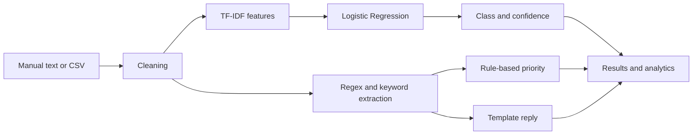

# Cynbit Inquiry Intelligence

A local, explainable proof of concept for sorting project inquiries into service categories and extracting details for human follow-up. This is an independent assessment prototype, not a Cynbit product or deployed integration.

## Why this opportunity

Cynbit publicly presents AI automation, custom software/cloud work, product demos, and an inquiry contact path. Its site already describes AI agents, AI coding evaluation/mentoring, and Revio review sentiment and response features. This project therefore explores a different workflow: **internal inquiry triage**. The public pages do not establish that Cynbit currently has this gap or uses this tool. No customer records or internal workflows were available.

## Features

- TF-IDF + Logistic Regression multiclass service classification.
- Confidence display and configurable low-confidence fallback to `Other (uncertain)`.
- Rule-based budget, timeline, service, and requirement extraction.
- High/medium/low heuristic priority with reasons, clearly separated from ML.
- Editable, template-based reply suggestion; no API key.
- Manual analysis, batch CSV processing/download, and interactive charts.
- 192 labeled synthetic inquiries for reproducible demonstration.

## Architecture



## Technology

Python 3.10+, Pandas, NumPy, scikit-learn, TF-IDF, Logistic Regression, Streamlit, Plotly, Joblib. The pipeline runs on CPU and requires no credentials.

## Project structure

```text
app.py                     Streamlit dashboard
train_model.py             Training, stratified split, metrics, model export
data/sample_inquiries.csv  Labeled synthetic examples
models/                    Trained pipeline and evaluation.json (generated)
utils/                     Cleaning, classifier, extractors, priority, response
reports/                   Opportunity and technical PDF reports
tests/                     Unit and application logic checks
requirements.txt
```

## Install and run (Windows PowerShell)

```powershell
cd .\Cynbit-Inquiry-Intelligence
py -3 -m venv .venv
.\.venv\Scripts\Activate.ps1
python -m pip install --upgrade pip
pip install -r requirements.txt
python train_model.py
streamlit run app.py
```

If PowerShell blocks activation, run `Set-ExecutionPolicy -Scope Process -ExecutionPolicy Bypass` in that terminal, then activate. To run checks: `python -m pytest -q`.

## How to train

`python train_model.py` reads `data/sample_inquiries.csv`, normalizes text, holds out a stratified 25% test split (random seed 42), trains a TF-IDF + balanced Logistic Regression pipeline, prints accuracy/macro precision/recall/F1 and writes a scikit-learn Joblib pipeline when that dependency is available, otherwise a transparent offline multinomial Naive Bayes model in JSON, plus `models/evaluation.json`. Current trained artifact uses the offline fallback because network installation was unavailable. The templated examples share patterns across the split; these metrics are only a pipeline smoke check, not a measure of production generalization.

## Sample

Input: `We need an AI dashboard integrated with our CRM. Budget is $20,000; delivery in 6 weeks.`

Expected output format: predicted category and probability, priority + heuristic reasons, extracted budget/timeline, service/requirement terms, and a draft response. Exact prediction and scores depend on the saved model. Review every prediction.

## Evaluation

The included fallback run produced 1.00 accuracy, macro precision, recall, and F1 on 48 synthetic held-out rows. These perfect scores are a consequence of repeated templated patterns and are not a meaningful estimate of real-world performance. See generated `models/evaluation.json`; no Cynbit data was used.

## Screenshots

No application UI screenshots are included. Capture the running dashboard before submission if your reviewer expects visual evidence.

## Limitations

- Synthetic, small, template-based dataset; no real customer inquiries and no validated label taxonomy.
- Confidence is not calibrated probability of correctness. Unknown/out-of-domain text may still receive a familiar class.
- Regex extraction is English-centric and may miss varied currency/date formats.
- Priority is a transparent heuristic, not a trained model or business policy.
- Reply drafts are generic and require human review. No CRM integration, persistence, authentication, or deployment is configured.

## Future work

Obtain permissioned, anonymized, representative labeled inquiries; define categories and priority with staff; evaluate temporal and source-held-out test sets; calibrate confidence and monitor drift; add privacy controls and audit trails; pilot with human-in-the-loop feedback before integrating with a CRM.

## Reports and research sources

- [AI Opportunity Report](reports/AI_Opportunity_Report.pdf)
- [Technical Approach Report](reports/Technical_Approach_Report.pdf)
- Cynbit [home](https://www.cynbit.in/), [services](https://www.cynbit.in/services), and [products](https://www.cynbit.in/products) pages, accessed 20 Nov 2026. See reports for distinctions between site claims and proposed opportunities.

## GitHub and Streamlit Community Cloud

1. Create an empty public repository on GitHub. From this project directory: `git init`, `git add .`, `git commit -m "Build inquiry intelligence prototype"`, `git branch -M main`, `git remote add origin https://github.com/<YOUR-USERNAME>/<REPO>.git`, `git push -u origin main`. Replace the placeholder with your repository URL; do not commit credentials.
2. For Streamlit Community Cloud, sign in at [share.streamlit.io](https://share.streamlit.io/), choose the repository and branch, set `app.py` as the entry point, and deploy. The app expects a committed model artifact from `models/` (`.joblib` or fallback `.json`). Train it locally before pushing. Current local deployment is the verified target; cloud deployment has not been performed.
