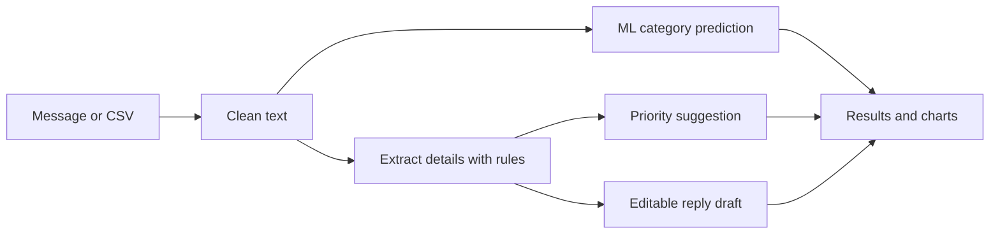

# Cynbit Inquiry Intelligence

A small AI/ML assessment project that helps organize project inquiries. The dashboard is labeled “Cynbit Revio - Inquiry Intelligence” for this assessment. It is an independent prototype, not an official Cynbit or Revio feature, and it is not connected to Cynbit systems.

## What it does

- Suggests a service category from an inquiry message.
- Pulls out details such as budget and timeline when they are in the message.
- Gives a simple priority suggestion and shows why.
- Drafts a reply that a person can edit.
- Analyzes a CSV of messages and shows basic charts.
- Includes a sample dashboard button so you can preview the app without providing data.

The sample inquiries are synthetic. They are not real customer messages.

## Why this idea

Cynbit's website describes AI and software services and includes inquiry and product demo paths. It also already presents AI features in products such as Cynbit Studio and Revio. This project explores inquiry organization as a different idea. The public website does not show whether Cynbit has this need today, so this is a proposal to validate, not a claim about the company's internal process.

## How it works



The preferred training setup uses TF-IDF and Logistic Regression. The included model also supports a small Naive Bayes fallback, used when scikit-learn is unavailable. Priority, detail extraction, and reply drafting are rule-based; they are separate from the classifier.

## Run on Windows

Open PowerShell in the extracted `Cynbit-Inquiry-Intelligence` folder, then run:

```powershell
py -3 -m venv .venv
.\.venv\Scripts\Activate.ps1
python -m pip install --upgrade pip
pip install -r requirements.txt
python train_model.py
streamlit run app.py
```

If PowerShell blocks activation, run `Set-ExecutionPolicy -Scope Process -ExecutionPolicy Bypass` in that terminal, then activate the environment. The app opens in your browser. On the Overview page, select **Load sample dashboard** to preview the charts, or open **Analyze Inquiry** to try your own message.

## Training and results

The included CSV has 192 synthetic examples across six categories. The current fallback model scored 1.00 on its small synthetic holdout set. That score is artificially high because the examples reuse similar templates. It only checks that the training flow runs; it does not predict how the model will perform on real inquiries. No Cynbit customer data was used.

A meaningful evaluation needs permissioned real examples, agreed category labels, and a separate test set that does not repeat the training templates.

## Project files

- `app.py` - Streamlit dashboard
- `train_model.py` - trains the classifier and saves evaluation results
- `data/sample_inquiries.csv` - synthetic examples
- `models/` - model and evaluation output
- `utils/` - text cleaning, classification, extraction, priority, and reply helpers
- `reports/` - the two assessment reports
- `tests/` - checks for the main app logic

## Limits

This is a local prototype. Confidence can be wrong, text extraction may miss unusual wording, and the priority rules are examples rather than Cynbit policy. The app does not save data after the session, connect to a CRM, or send replies. Review every result before using it.
